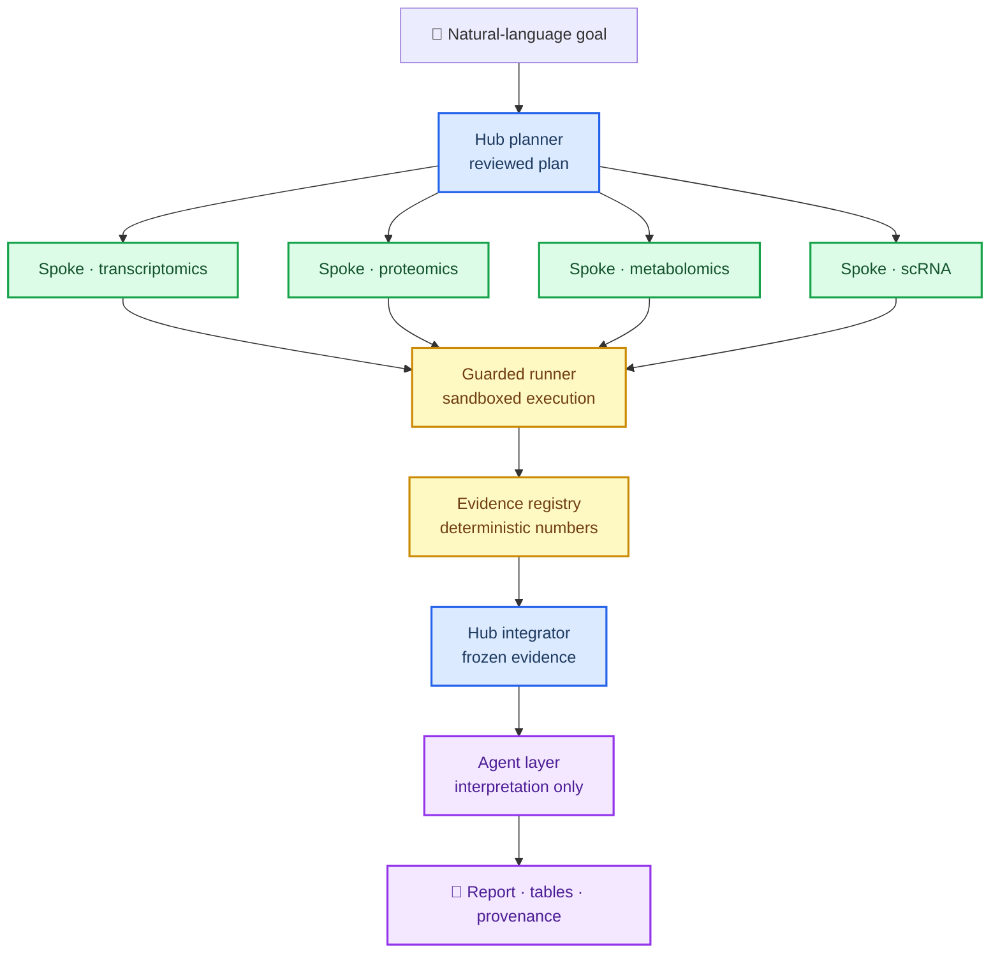

<p align="center">
  <picture>
    <source media="(prefers-color-scheme: dark)" srcset="assets/logo-on-dark.svg">
    
  </picture>
</p>

<h1 align="center">tme_agent</h1>

<p align="center">
  <a href="README.md">English</a> ·
  <a href="README.zh-CN.md">简体中文</a>
</p>

<p align="center">
  <a href="https://github.com/shineshen007/tme_agent/stargazers">
    
  </a>
  <a href="https://github.com/shineshen007/tme_agent/releases">
    
  </a>
  <a href="LICENSE">
    
  </a>
  <a href="https://www.python.org/">
    
  </a>
  <a href="https://www.r-project.org/">
    
  </a>
</p>

<p align="center">A natural-language multi-omics analysis expert in your terminal.</p>

<p align="center">
  
</p>

tme_agent turns the data you provide and the research direction you care about into a reviewed,
executable plan. It binds the goal to concrete inputs, proposes a method and code, and waits for
your approval before anything runs. Every task keeps its own log, its complete results, and the
provenance needed to trace each number back to the file it came from.

- **Plan before run:** Every task is bound to declared inputs, a chosen method, and generated
  code that you review and confirm before execution.
- **Hub-and-spoke orchestration:** A planner fans work out to per-omics spokes and integrates
  their evidence; the model interprets, but never authors a statistic.
- **Numbers are injected, not generated:** Every figure and number in a report is read from the
  deterministic evidence registry, not written by a language model.
- **Reproducible by construction:** Task logs, complete result tables, and provenance records are
  kept for every run; nothing is overwritten in a completed run directory.
- **Guardrails in code, not only prompts:** Input binding, sandboxed execution, and refusal of
  cohort identifiers are enforced by the runner, not left to the prompt.
- **Bring your own model:** Configure the service with `/model` and the key with `/key`; the key
  is stored in the system credential vault and never written to config, logs, or Git.
- **Workspaces on demand:** launch from any directory with the installed `multiomics` command;
  `/cd` switches or initializes a workspace without copying the code tree or overwriting files.
- **Command completion:** type `/` to list commands with a one-line hint; `↑`/`↓` choose, `Tab`
  completes, and `/new` returns to the welcome screen while keeping the draft and history.
- **Research continuation:** approved disease context and evidence mappings connect completed
  analysis to literature checks, biological interpretation, falsifiable hypotheses and experiment design.
  `/research` retries this stage while preserving completed statistics.
- **Scientific Wiki:** reviewed, versioned project knowledge and explicitly published local shared
  entries support planning, interpretation and experiments. `/wiki` manages review and retraction;
  `/ask` retrieves reviewed knowledge. See the [research workflow and limits](docs/RESEARCH_EXPERT.md).

## Architecture

The public entry point is a natural-language task. A hub planner produces a plan, per-omics
spokes run under the guarded runner, an integrator freezes the evidence, and the agent layer
interprets it — with all statistics injected from the registry.



## Agents

Each agent has one job, and the hard rules are enforced in code rather than only in the prompt.

| Agent | Role |
| --- | --- |
| **Hub planner** | Turns a goal into a reviewed plan bound to declared inputs and methods. |
| **Spoke agents** | Per-omics analysis for transcriptomics, proteomics, metabolomics, and scRNA. |
| **Evidence integrator** | Freezes the evidence registry; the only source of numbers. |
| **Analyst** | Reads frozen evidence and produces structured, schema-validated interpretation. |
| **Hypothesis reasoner** | Proposes testable hypotheses with counter-evidence and explicit unknowns. |
| **Critic** | Reviews agent output for overreach, unsupported claims, and schema drift. |
| **Librarian** | Retrieves literature, keeping machine stance separate and review pending. |
| **Reanalysis proposer** | Suggests follow-up analysis without changing frozen thresholds. |
| **Synthesizer** | Renders the final report; every number is injected, never authored. |

## Getting Started

### Prerequisites

- **Python 3.12–3.14** and **R 4.4+**. Existing software is reused; dependencies are only
  filled in up to the project environment.

### Install

Download `tme_agent-vX.Y.Z.zip` and its matching checksum list from
[Releases](https://github.com/shineshen007/tme_agent/releases), verify the SHA256, and extract
into a new, writable directory. Use the **Release asset ZIP** — the GitHub-generated
“Source code” ZIP is maintainer source, has no install manifest, and cannot be used for release
updates.

On macOS/Windows you can use `setup_macos.command` / `setup_windows.cmd`, or run from the project
directory:

```bash
python -m native_dist.bootstrap check
python -m native_dist.bootstrap setup
```

After setup, the installer also creates a user-level `multiomics` command
(`~/.local/bin/multiomics`, or `%USERPROFILE%\.local\bin\multiomics.cmd` on Windows) and adds
that directory to your user PATH. Open a new terminal, then run from any directory:

```bash
multiomics
multiomics --project-root /path/to/workspace
multiomics update --check
```

`multiomics` starts in the install workspace. Inside the interface, `/cd <directory>` switches
the working workspace for the current session; `/cd` shows the current path. A directory without
configuration is initialized from the installed template without overwriting existing files.
`/cd` does not change the parent shell directory and is not remembered across restarts.

The launcher uses the project `.venv`; you do not need to activate it. For a manual start, or if
PATH activation was skipped (`setup --no-path`), activate `.venv` (macOS/Linux:
`source .venv/bin/activate`; Windows PowerShell: `.venv\Scripts\Activate.ps1`, or use
`.venv\Scripts\python.exe` directly). Below, `python` means the `.venv` Python in the install
directory.

```bash
python -m multiomics_tui
```

To inspect or remove the launcher and its managed PATH entry:

```bash
python -m native_dist.command_link status
python -m native_dist.command_link uninstall
```

The first install generates local configuration and a 4 × 4 synthetic expression example. The
dependency check looks for compatible user-installed interpreters and packages first (user
site, pyenv/uv/conda, `R_LIBS_USER`) and only fills missing dependencies into the project
environment. Put
your real data under local `data/raw/`, `data/metadata/`, and `data/signature/` — do not upload
these directories. Set the service with `/model` and enter the key in the masked field with
`/key`; the key uses the system credential vault. The `/model` panel asks only for the service,
endpoint, model, authentication, and key; timeout, output limit, JSON mode, token field, and
temperature stay in local `config/api.local.yaml` (default output limit: 32000 tokens). On Linux without a desktop credential service,
you may explicitly set local config `distribution.credential_storage` to `memory`, where the key
lives only for the current process and is never written to disk. **Diagnostics run offline even
without a model key.**

### Built-in dataset

The install ships one open-access TCGA-LIHC bulk RNA-seq dataset (`datasets/TCGA-LIHC/`, about
36 MB), downloaded from the NCI Genomic Data Commons **STAR - Counts** pipeline with
**GENCODE v36**: raw `unstranded` counts, `tpm_unstranded`, and a gene annotation for 19938
protein-coding genes × 424 samples — 371 primary tumours, 50 adjacent tissues and 3 recurrent
tumours, with 50 patients having a tumour/adjacent pair. Install and `/cd` into a new workspace
copy the files to `data/raw/TCGA-LIHC/` and `data/metadata/TCGA-LIHC/`; existing files are never
overwritten.

```bash
# inside the interface: dimensions, groups and the frozen input bindings
/datasets
```

Matrices are RDS (gene symbols as row names, 16-character TCGA sample barcodes as column names)
and drop straight into a plan's `input_bindings.matrices`; `/datasets` prints the full JSON. Use
`counts_paired.rds` (`pair_key: pair_id`) for tumour/adjacent paired analysis, or
`counts_full.rds` / `tpm_full.rds` for the whole cohort. Formats, column definitions, example
requests and limits are in `datasets/TCGA-LIHC/README.md`; the GDC project, data release, upstream
pipeline and per-file md5 checksums are recorded in `dataset.json`
(`provenance_status: recorded`). Only protein-coding genes ship, so TPM column sums are below the
full-transcriptome 1e6 — never rescale them or merge them with another TPM dataset.

Natural-language tasks are the public entry point. Historical fixed study pipelines need a
separate cohort configuration and cannot be restored from the public template. Model-generated
explanations and code are **not** independent validation — confirm the statistical unit,
grouping, and study design before you rely on a result.

Slash commands are discoverable without memorizing them: type `/` and the interface lists
matching commands with a one-line hint, `↑`/`↓` move the highlight, `Tab` (or `Enter`) accepts the
highlighted command, and `Esc` closes the list. Accepting only fills in the command name; nothing
runs until you press Enter again, and arguments follow the name. While a request is running only
read-only commands appear. `/new` starts a separate task and returns to the welcome screen; the
draft task and its history stay on disk and can be reopened with `/sessions` or
`/session <task-id>`.

## Update and Rollback

Close the interface and finish or stop background tasks, then run from any directory:

```bash
multiomics update --check
multiomics update
multiomics update --version vX.Y.Z
multiomics update --rollback
```

The same commands work as `python -m multiomics_tui update ...` from the install directory.
Updates default to the latest stable Release. The updater verifies the download, file manifest,
and task locks; it refuses to overwrite locally modified source. Data, results, personal config,
and the existing environment are never replaced by the release package. If applying code or
preparing the environment fails, the release source is restored; new dependencies are not
automatically uninstalled. Success is reported only when code, environment, and diagnostics all
pass. Restart the interface when done.

## Docs and Status

- [Install, update, and rollback](docs/INSTALL_UPDATE_zh.md)
- [Third-party resources and local data](docs/THIRD_PARTY_RESOURCES.md)
- [Source provenance and baseline](docs/V8_SOURCE.json)
- [Local validation results](docs/VALIDATION.md)
- [Current delivery status](CURRENT_STATE.md)
- [Changelog](CHANGELOG.md)
- [License notice](docs/LICENSE_NOTICE.md)

Windows, Intel Mac, and Apple Silicon native isolation still require on-device testing; portable
CI does not substitute for native acceptance. `python -m native_dist.diagnostics --project-root .`
runs only local checks and synthetic tasks, and does not call a real model API.

## License

GPL-3.0-or-later. See [LICENSE](LICENSE).
