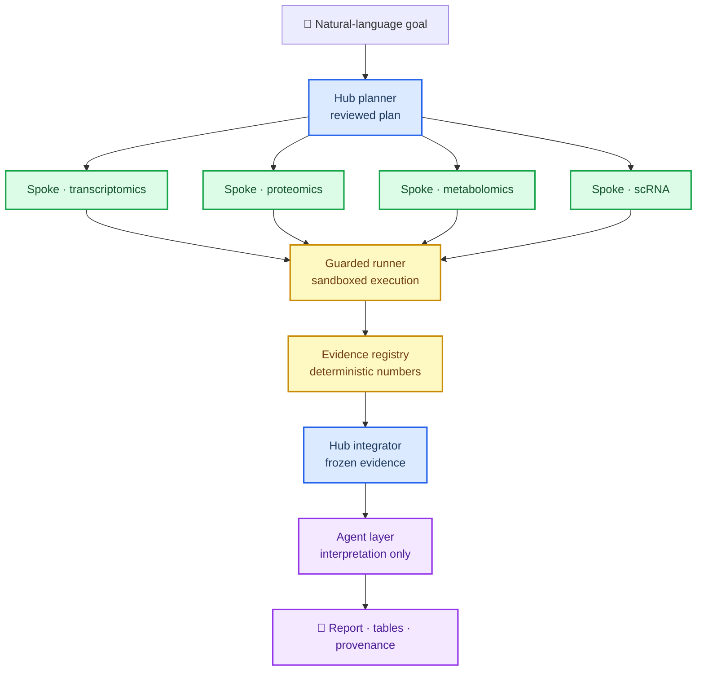

<p align="center">
  <picture>
    <source media="(prefers-color-scheme: dark)" srcset="assets/logo-on-dark.svg">
    
  </picture>
</p>

<h1 align="center">tme_agent</h1>

<p align="center">
  <a href="README.md">English</a> ·
  <a href="README.zh-CN.md">简体中文</a>
</p>

<p align="center">
  <a href="https://github.com/shineshen007/tme_agent/stargazers">
    
  </a>
  <a href="https://github.com/shineshen007/tme_agent/releases">
    
  </a>
  <a href="LICENSE">
    
  </a>
  <a href="https://www.python.org/">
    
  </a>
  <a href="https://www.r-project.org/">
    
  </a>
</p>

<p align="center">A natural-language terminal workspace for reproducible multi-omics analysis.</p>

<p align="center">
  
</p>

tme_agent turns a stated analysis goal into a reviewed, executable plan. You describe what you
want, the agent binds it to concrete inputs, proposes a method and code, and waits for your
approval before anything runs. Every task keeps its own log, its complete results, and the
provenance needed to trace each number back to the file it came from.

The public release is **GPL-3.0-or-later** and ships **no patient data and no original study
results** — only source, templates, and a synthetic example.

- **Plan before run:** Every task is bound to declared inputs, a chosen method, and generated
  code that you review and confirm before execution.
- **Hub-and-spoke orchestration:** A planner fans work out to per-omics spokes and integrates
  their evidence; the model interprets, but never authors a statistic.
- **Numbers are injected, not generated:** Every figure and number in a report is read from the
  deterministic evidence registry, not written by a language model.
- **Reproducible by construction:** Task logs, complete result tables, and provenance records are
  kept for every run; nothing is overwritten in a completed run directory.
- **Guardrails in code, not only prompts:** Input binding, sandboxed execution, and refusal of
  cohort identifiers are enforced by the runner, not left to the prompt.
- **Bring your own model:** Configure the service with `/model` and the key with `/key`; the key
  is stored in the system credential vault and never written to config, logs, or Git.
- **Offline by default:** With no model key, diagnostics and the synthetic example still run.

## Architecture

The public entry point is a natural-language task. A hub planner produces a plan, per-omics
spokes run under the guarded runner, an integrator freezes the evidence, and the agent layer
interprets it — with all statistics injected from the registry.



## Agents

Each agent has one job, and the hard rules are enforced in code rather than only in the prompt.

| Agent | Role |
| --- | --- |
| **Hub planner** | Turns a goal into a reviewed plan bound to declared inputs and methods. |
| **Spoke agents** | Per-omics analysis for transcriptomics, proteomics, metabolomics, and scRNA. |
| **Evidence integrator** | Freezes the evidence registry; the only source of numbers. |
| **Analyst** | Reads frozen evidence and produces structured, schema-validated interpretation. |
| **Hypothesis reasoner** | Proposes testable hypotheses with counter-evidence and explicit unknowns. |
| **Critic** | Reviews agent output for overreach, unsupported claims, and schema drift. |
| **Librarian** | Retrieves literature, keeping machine stance separate and review pending. |
| **Reanalysis proposer** | Suggests follow-up analysis without changing frozen thresholds. |
| **Synthesizer** | Renders the final report; every number is injected, never authored. |

## Getting Started

### Prerequisites

- **Python 3.12–3.14** and **R 4.4+**. Existing software is reused; dependencies are only
  filled in up to the project environment.

### Install

Download `tme_agent-vX.Y.Z.zip` and its matching checksum list from
[Releases](https://github.com/shineshen007/tme_agent/releases), verify the SHA256, and extract
into a new, writable directory. Use the **Release asset ZIP** — the GitHub-generated
“Source code” ZIP is maintainer source, has no install manifest, and cannot be used for release
updates.

On macOS/Windows you can use `setup_macos.command` / `setup_windows.cmd`, or run from the project
directory:

```bash
python -m native_dist.bootstrap check
python -m native_dist.bootstrap setup
```

After install, activate `.venv` (macOS/Linux: `source .venv/bin/activate`; Windows PowerShell:
`.venv\Scripts\Activate.ps1`, or use `.venv\Scripts\python.exe` directly). Below, `python` means
the `.venv` Python in the install directory.

```bash
python -m multiomics_tui
```

The first install generates local configuration and a 4 × 4 synthetic expression example. Put
your real data under local `data/raw/`, `data/metadata/`, and `data/signature/` — do not upload
these directories. Set the service with `/model` and enter the key in the masked field with
`/key`; the key uses the system credential vault. On Linux without a desktop credential service,
you may explicitly set local config `distribution.credential_storage` to `memory`, where the key
lives only for the current process and is never written to disk. **Diagnostics run offline even
without a model key.**

Natural-language tasks are the public entry point. Historical fixed study pipelines need a
separate cohort configuration and cannot be restored from the public template. Model-generated
explanations and code are **not** independent validation — confirm the statistical unit,
grouping, and study design before you rely on a result.

## Update and Rollback

Close the interface and finish or stop background tasks, then run from the install directory:

```bash
python -m multiomics_tui update --check
python -m multiomics_tui update
python -m multiomics_tui update --version vX.Y.Z
python -m multiomics_tui update --rollback
```

Updates default to the latest stable Release. The updater verifies the download, file manifest,
and task locks; it refuses to overwrite locally modified source. Data, results, personal config,
and the existing environment are never replaced by the release package. If applying code or
preparing the environment fails, the release source is restored; new dependencies are not
automatically uninstalled. Success is reported only when code, environment, and diagnostics all
pass. Restart the interface when done.

## Development

This directory keeps the existing `main` history; the first upload is reviewed here.

```bash
git status --short
python -m native_dist.public_release audit
python -m pytest -q
```

Stage only the allowlisted files, so local data never enters Git:

```bash
python -c "import json,subprocess; subprocess.run(['git','add','--',*json.load(open('PUBLIC_FILES.json',encoding='utf-8'))['files']],check=True)"
git diff --cached --stat
git commit -m "Release public vX.Y.Z"
git push origin main
git tag -a vX.Y.Z -m "Public vX.Y.Z"
git push origin vX.Y.Z
```

The tag triggers Actions validation and Release generation. Public source, install packages, and
manifests carry no study data. Confirm GitHub Actions is enabled and you have push rights before
publishing; Git uses your own secure authentication — never write a token into config or a
command.

When you add files, maintain the explicit allowlist in `PUBLIC_FILES.json` and update
`CHANGELOG.md`, then run (example: `vX.Y.Z`):

```bash
git pull --ff-only origin main
python -m native_dist.public_release prepare --version X.Y.Z
python -m pytest -q
python -m native_dist.public_release build --output dist
python -c "import json,subprocess; subprocess.run(['git','add','--',*json.load(open('PUBLIC_FILES.json',encoding='utf-8'))['files']],check=True)"
git diff --cached --stat
git commit -m "Release vX.Y.Z"
git push origin main
git tag -a vX.Y.Z -m "Release vX.Y.Z"
git push origin vX.Y.Z
```

When deleting files, remove them from the allowlist first, then `git rm -- <path>` explicitly.
Never replace published content under the same version number. Maintainers update the local
runtime with `python -m native_dist.bootstrap setup`.

## Docs and Status

- [Install, update, and rollback](docs/INSTALL_UPDATE_zh.md)
- [Third-party resources and local data](docs/THIRD_PARTY_RESOURCES.md)
- [Source provenance and baseline](docs/V8_SOURCE.json)
- [Local validation results](docs/VALIDATION.md)
- [Current delivery status](CURRENT_STATE.md)
- [Changelog](CHANGELOG.md)
- [License notice](docs/LICENSE_NOTICE.md)

Windows, Intel Mac, and Apple Silicon native isolation still require on-device testing; portable
CI does not substitute for native acceptance. `python -m native_dist.diagnostics --project-root .`
runs only local checks and synthetic tasks, and does not call a real model API.

## License

GPL-3.0-or-later. See [LICENSE](LICENSE).
