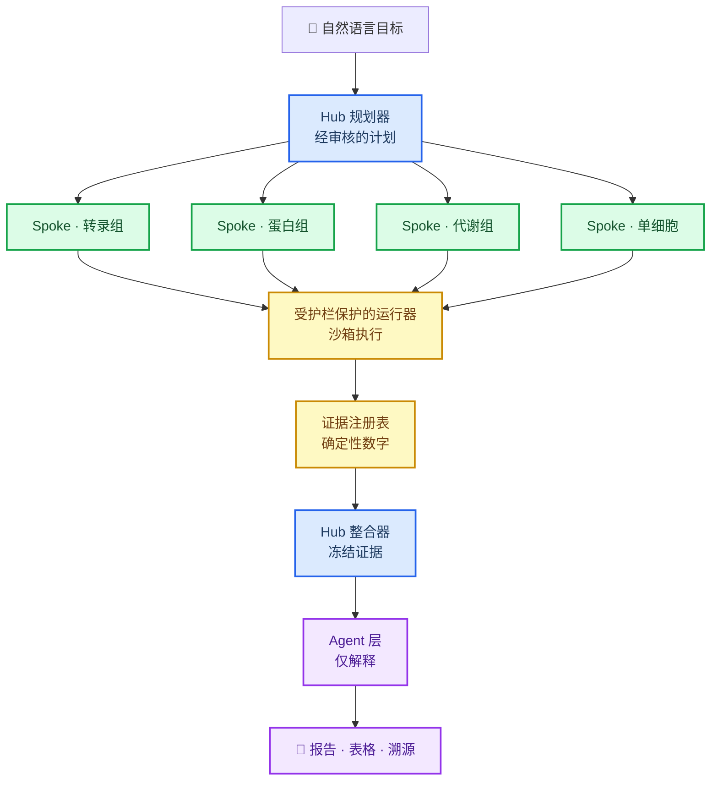

<p align="center">
  <picture>
    <source media="(prefers-color-scheme: dark)" srcset="assets/logo-on-dark.svg">
    
  </picture>
</p>

<h1 align="center">tme_agent</h1>

<p align="center">
  <a href="README.md">English</a> ·
  <a href="README.zh-CN.md">简体中文</a>
</p>

<p align="center">
  <a href="https://github.com/shineshen007/tme_agent/stargazers">
    
  </a>
  <a href="https://github.com/shineshen007/tme_agent/releases">
    
  </a>
  <a href="LICENSE">
    
  </a>
  <a href="https://www.python.org/">
    
  </a>
  <a href="https://www.r-project.org/">
    
  </a>
</p>

<p align="center">基于自然语言的终端多组学分析专家。</p>

<p align="center">
  
</p>

tme_agent 把你提供的数据和感兴趣的科研方向，转化为经审核、可执行的计划。它将目标绑定到
具体输入，给出方法与代码，并在任何执行前等待你确认。每个任务都保留自己的日志、完整结果，
以及把每个数字回溯到来源文件所需的溯源信息。

- **先计划再执行：** 每个任务都绑定到声明的输入、选定的方法和生成的代码，经你审核确认后才运行。
- **Hub–spoke 编排：** 规划器把工作分派到各 omics spoke 并整合其证据；模型负责解释，但从不编写统计量。
- **数字注入而非生成：** 报告中的每个数字和图都来自确定性的证据注册表，而不是由语言模型撰写。
- **结构上可复现：** 每次运行都保留任务日志、完整结果表和溯源记录；已完成的运行目录不会被覆盖。
- **护栏写在代码里：** 输入绑定、沙箱执行和拒绝队列标识符由运行器强制执行，而不是只写在提示词中。
- **自带模型：** 用 `/model` 设置服务，用 `/key` 输入密钥；密钥存入系统凭据库，绝不写入配置、日志或 Git。

## 架构

公开入口是自然语言任务。Hub 规划器生成计划，各 omics spoke 在受护栏保护的运行器下执行，
整合器冻结证据，agent 层对其进行解释——所有统计量都从注册表注入。



## Agents

每个 agent 只负责一件事，硬性规则由代码强制执行，而不只写在提示词里。

| Agent | 职责 |
| --- | --- |
| **Hub 规划器** | 把目标变成绑定到声明输入和方法的经审核计划。 |
| **Spoke agents** | 转录组、蛋白组、代谢组和单细胞的各 omics 分析。 |
| **证据整合器** | 冻结证据注册表；数字的唯一来源。 |
| **分析师** | 读取冻结证据，产出结构化、通过 schema 校验的解释。 |
| **假设推理器** | 提出可检验假设，附带反证和明确的未知项。 |
| **批评者** | 审查 agent 输出是否越界、缺乏支持或 schema 漂移。 |
| **文献员** | 检索文献，机器立场与人工评审状态分离。 |
| **再分析提议者** | 在不改变冻结阈值的前提下建议后续分析。 |
| **综合器** | 渲染最终报告；每个数字都是注入的，而不是撰写的。 |

## 快速开始

### 前置条件

- **Python 3.12–3.14** 和 **R 4.4+**。已有软件直接复用，依赖只补齐到项目环境。

### 安装

在 [Releases](https://github.com/shineshen007/tme_agent/releases) 下载 `tme_agent-vX.Y.Z.zip` 和
同版本校验清单，核对 SHA256 后完整解压到新的、可写目录。请使用 **Release 附件 ZIP**——
GitHub 自动生成的 “Source code” ZIP 是维护源码，没有安装清单，不能用于发行更新。

Mac/Windows 可使用 `setup_macos.command` / `setup_windows.cmd`，也可在项目目录运行：

```bash
python -m native_dist.bootstrap check
python -m native_dist.bootstrap setup
```

安装后激活 `.venv`（Mac/Linux：`source .venv/bin/activate`；Windows PowerShell：
`.venv\Scripts\Activate.ps1`，或直接使用 `.venv\Scripts\python.exe`）。下文 `python` 均指安装
目录的 `.venv` Python。

```bash
python -m multiomics_tui
```

首次安装生成本地配置和 4 × 4 合成表达示例。真实数据自行放入本地 `data/raw/`、
`data/metadata/`、`data/signature/`；不要上传这些目录。界面 `/model` 设置服务，`/key` 在掩码框
输入密钥并使用系统凭据库。Linux 无桌面凭据服务时，可显式将本地配置
`distribution.credential_storage` 改为 `memory`，密钥仅本次进程有效，不写磁盘。**无模型密钥也能
运行离线诊断。**

自然语言新任务是公开版入口。原固定研究流程需要独立的队列配置，不可用公开模板恢复。
模型生成的解释和代码**不代表**独立验证，分析前仍需确认统计单位、分组和研究设计。

## 更新与回滚

关闭界面、完成或停止后台任务，在安装目录运行：

```bash
python -m multiomics_tui update --check
python -m multiomics_tui update
python -m multiomics_tui update --version vX.Y.Z
python -m multiomics_tui update --rollback
```

默认更新到最新正式 Release。更新验证下载、文件清单和任务锁；源码有本地改动时拒绝覆盖。
数据、结果、个人配置和已有环境不被发行包替换。代码应用或环境准备失败时恢复发行源码；
新增依赖不自动卸载。只有代码、环境和诊断均通过才报告成功。完成后重新启动界面。

## 文档与状态

- [安装、更新和回滚](docs/INSTALL_UPDATE_zh.md)
- [第三方资源与本地数据](docs/THIRD_PARTY_RESOURCES.md)
- [源码来源与基线](docs/V8_SOURCE.json)
- [本地验证结果](docs/VALIDATION.md)
- [当前交付状态](CURRENT_STATE.md)
- [版本记录](CHANGELOG.md)
- [许可声明](docs/LICENSE_NOTICE.md)

Windows、Intel Mac 和 Apple Silicon 的原生隔离仍需目标机器实测；CI 的便携测试不代替原生隔离
验收。`python -m native_dist.diagnostics --project-root .` 只运行本地检查与合成任务，不调用真实
模型 API。

## 许可

GPL-3.0-or-later。见 [LICENSE](LICENSE)。
